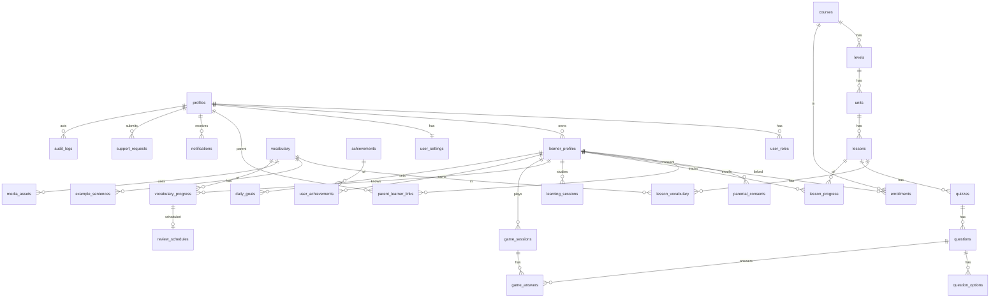

# ERD – LIÊN HOA KID (30 bảng, PostgreSQL / Supabase)

Trạng thái: **CHỜ DUYỆT**, chưa có migration.

## Nguyên tắc
- Khóa chính UUID (`gen_random_uuid()`); mọi bảng nghiệp vụ có `created_at`, `updated_at`.
- Nội dung có `status`: `draft | published | archived`.
- Nội dung học (courses → lessons) được đọc bởi mọi người dùng đã đăng nhập khi `published`.
- Dữ liệu kết quả (progress, game, XP) **chỉ ghi qua RPC `SECURITY DEFINER`**, client không INSERT/UPDATE trực tiếp.
- Quyền xác định bằng `user_roles` + hàm `has_role()`, không tin claim do client gửi.

## Quyết định cần duyệt
- **Q1.** Hồ sơ trẻ (`learner_profiles`) là bản ghi do phụ huynh sở hữu (`owner_id`), không bắt buộc có tài khoản `auth.users` riêng. Người lớn tự học: tài khoản vừa là chủ vừa là học viên (`owner_id = auth_user_id`, `is_self = true`).
- **Q2.** `parent_learner_links` vẫn giữ để một hồ sơ có thể liên kết thêm phụ huynh thứ hai (ví dụ mẹ và bố) và để phân quyền xem.
- **Q3.** `parental_consents` ghi phiên bản chính sách, thời điểm, phương thức xác nhận; bắt buộc trước khi tạo hồ sơ dưới 16 tuổi (ngưỡng cần đối chiếu pháp luật VN).

## Sơ đồ quan hệ chính

## Bảng và cột chính

### Tài khoản
| Bảng | Cột chính |
|---|---|
| `profiles` | id (= auth.users.id), display_name, phone?, created_at |
| `user_roles` | user_id, role (`SUPER_ADMIN/ADMIN/CONTENT_EDITOR/PARENT/LEARNER`), UNIQUE(user_id, role) |
| `learner_profiles` | id, owner_id → profiles, display_name, avatar, age_group, birth_year?, level, goal, is_self, status, xp_total, streak_days, last_study_date |
| `parent_learner_links` | parent_id, learner_id, status, UNIQUE(parent_id, learner_id) |
| `parental_consents` | learner_id, parent_id, policy_version, consented_at, method, revoked_at? |
| `user_settings` | user_id, locale, sound_on, reminder_time |

### Học liệu
| Bảng | Cột chính |
|---|---|
| `courses` | slug, title, description, track (`intro/basic/conversation/hsk/topic`), status, sort_order |
| `levels` | course_id, code (ví dụ HSK1), title, sort_order, status |
| `units` | level_id, title, sort_order, status |
| `lessons` | unit_id, type (`vocab/pinyin/pronunciation/sentence/listening/reading/conversation/topic/test`), title, objective, sort_order, status |
| `vocabulary` | hanzi, pinyin, tone_marks, meaning_vi, pos, level_code, topic, status |
| `lesson_vocabulary` | lesson_id, vocabulary_id, sort_order |
| `media_assets` | kind (`image/audio`), storage_path, vocabulary_id?, lesson_id?, mime, size_bytes |
| `example_sentences` | vocabulary_id, hanzi, pinyin, meaning_vi, audio_asset_id? |

### Bài tập và trò chơi
| Bảng | Cột chính |
|---|---|
| `quizzes` | lesson_id, title, pass_score, status |
| `questions` | quiz_id?, vocabulary_id?, type, prompt, difficulty, status |
| `question_options` | question_id, text, is_correct (**ẩn với client**, chỉ RPC đọc) |
| `game_sessions` | learner_id, game_type (8 loại), difficulty, started_at, ended_at, score, correct_count, wrong_count, xp_awarded |
| `game_answers` | session_id, question_id, option_id, is_correct, time_ms |

### Tiến độ
| Bảng | Cột chính |
|---|---|
| `enrollments` | learner_id, course_id, current_level_id, status, UNIQUE(learner_id, course_id) |
| `lesson_progress` | learner_id, lesson_id, started_at, completed_at, score, correct, wrong, status |
| `learning_sessions` | learner_id, started_at, ended_at, duration_sec |
| `vocabulary_progress` | learner_id, vocabulary_id, box (hộp ôn 0–5), correct_streak, last_seen_at, UNIQUE(learner_id, vocabulary_id) |
| `review_schedules` | vocabulary_progress_id, due_at, interval_days |
| `achievements` | code, title, condition_type, threshold, icon |
| `user_achievements` | learner_id, achievement_id, earned_at |
| `daily_goals` | learner_id, goal_date, target_minutes, target_words, achieved |

### Quản trị
| Bảng | Cột chính |
|---|---|
| `notifications` | recipient_id, type, title, body, read_at |
| `support_requests` | user_id, subject, message, status, reply, replied_by |
| `audit_logs` | actor_id, action, table_name, record_id, diff (jsonb), at |

## Thuật toán ôn tập (bản 1.0)
Hộp Leitner đơn giản: đúng thì tăng `box`, sai thì về box 0 hoặc 1; `interval_days` theo bảng cố định (1, 2, 4, 7, 15, 30). Nâng cấp thuật toán sau khi có dữ liệu thực.

## Thay đổi so với danh sách 30 bảng gốc
Không thêm bớt bảng. Hai điểm làm rõ: `question_options.is_correct` không cho client đọc; `learner_profiles` mang `xp_total`, `streak_days` (chỉ RPC cập nhật).
